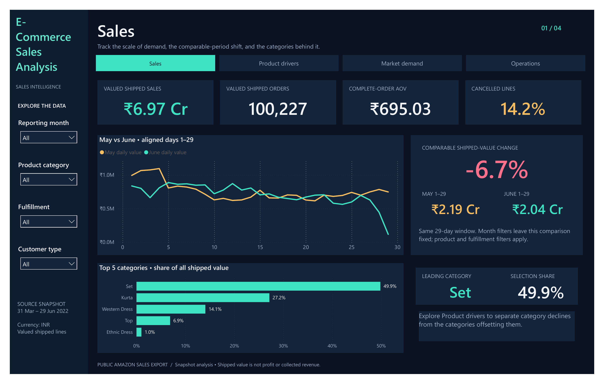
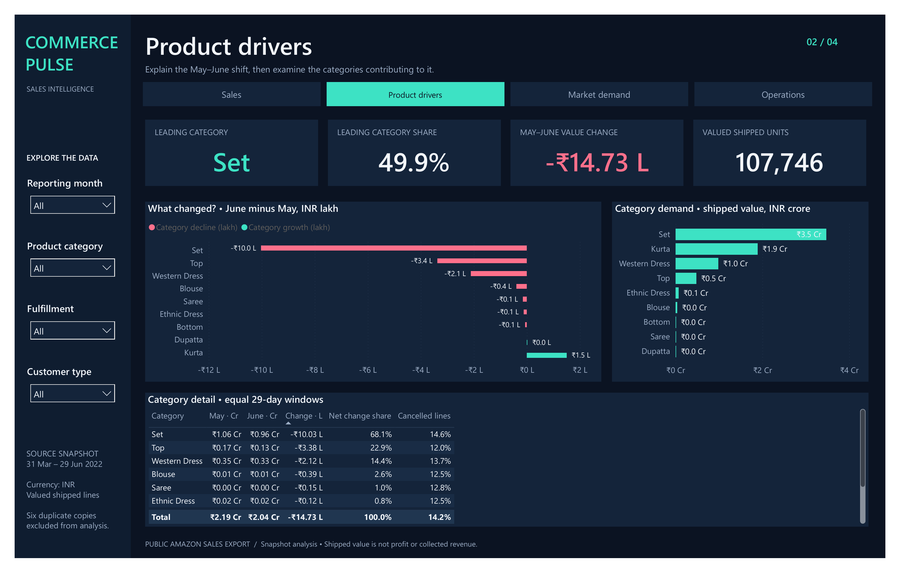
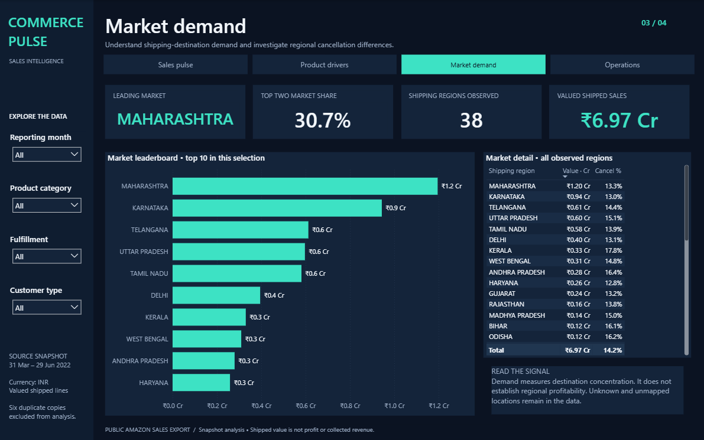
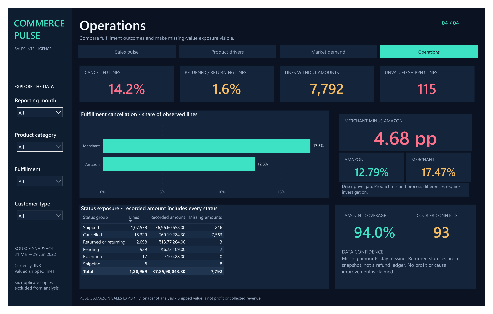

# Commerce Pulse — E-Commerce Sales Analytics

By **Dakshesh Gautam**. An analytics portfolio project that takes a historical e-commerce export from data cleaning to an interactive SQL and AI analyst.

**[Open the live app](https://dakshesh-commerce-pulse.streamlit.app/)**

**[Download the PDF analytics report](reports/CommercePulse-Analytics-Report.pdf)**

## Explore

- **Query Explorer:** 15 reviewed analyses with category, state, fulfillment, customer type and date filters. Charts, CSV downloads and the executed SQL accompany every result.
- **Ask Groq:** GPT-OSS 120B uses bounded tool calls to combine SQL results with cited project documentation. Gemini provides document-search embeddings. Unsupported profit, customer retention and causal questions are identified explicitly. Provider quota limits can temporarily interrupt chat; Query Explorer remains available.
- **Metric Guide:** definitions, cleaning decisions and data limitations.
- **Analytics report PDF:** the button beneath the app heading opens the [report hosted in the portfolio](https://daksheshgautam.github.io/projects/CommercePulse-Analytics-Report.pdf), with methodology, dashboard figures, evidence-backed findings, proposed investigations and limitations.
- **Power BI:** four dashboard previews available inside the app. [Download the editable Power BI report](powerbi/CommercePulse.pbix) and open it in Power BI Desktop.

## Data and methods

The Amazon snapshot covers **31 March–29 June 2022**. The model retains 128,975 source lines, flags six duplicate copies and analyses **128,969 lines across 120,378 orders**. Valued shipped sales are **₹69,660,658**, a sales proxy rather than collected or audited revenue. May/June comparisons use days 1–29 in both months.

Python prepares a MySQL star schema with four dimensions and one fact table. Bound SQL parameters, an allowlisted analysis registry, a SELECT-only database account and read-only sessions constrain database access. Remote connections validate the server certificate and hostname. Document retrieval uses five project documents, including the updated analytics report, and a prebuilt 33-passage index; generated prose is checked against numeric evidence and known citation IDs.

This repository contains the web deployment and an editable Power BI report with an imported data model from the public dataset. Raw source CSV files, database backups and credentials stay outside GitHub. Dataset attribution: [E-Commerce Sales Dataset on Kaggle](https://www.kaggle.com/datasets/thedevastator/unlock-profits-with-e-commerce-sales-data).

Deployment checks passed: 26 local checks and all 14 baseline analyses on Aiven MySQL 8.4.11, using certificate-verified TLS and a SELECT-only reader. Results are recorded in [reports/deployment-checks.json](reports/deployment-checks.json) and [reports/cloud-database-checks.json](reports/cloud-database-checks.json).

## Analytics report

**Prepared by Dakshesh Gautam | Report prepared 13 October 2026**

**Data period: 31 March to 29 June 2022 | Descriptive analysis of a public historical snapshot**

### 1. Executive summary and objectives

This descriptive analysis examines a public Amazon sales export covering 31 March to 29 June 2022. It reports 128,969 retained order lines across 120,378 orders. These are historical exported records, not a live Amazon feed or audited accounting results. [E1, M1]

| Measure | Observed value | Evidence |
| --- | --- | --- |
| Valued shipped sales | INR 69,660,658 (6.97 crore) | E1 |
| Valued shipped orders / units | 100,227 / 107,746 | E1 |
| Complete-order AOV | INR 695.03 | E8 |
| Cancelled-line rate | 14.21% (18,329 of 128,969 lines) | E1 |

The matched May/June comparison shows a 6.72% decline in shipped value. Set accounts for 68.08% of that net decline. Maharashtra and Karnataka account for 30.71% of snapshot shipped value. Merchant cancellation rates are 4.68 percentage points higher than Amazon rates. These observations describe the export; they do not establish causes. [E2-E6]

#### Problem statement

How did shipped sales value change between comparable periods, which product categories contributed to that change, where was shipped value concentrated, and how did observed cancellation and data-quality patterns differ?

#### Objectives

1. Define consistent measures and compare equal calendar windows. 2. Quantify category contributions and regional value shares. 3. Compare fulfillment outcomes using explicit denominators. 4. Document quality gaps and evidence limits, then propose follow-up investigations.

### 2. Dataset, methodology and metric definitions

The main analytical dataset is the Amazon sales report from the public E-Commerce Sales Dataset on Kaggle. All 128,975 source lines are retained in storage; the analytical view excludes six flagged later copies, leaving 128,969 lines. Other source files were not joined into the main model without demonstrated compatible grains. [M1, M2]

#### Preparation and analysis

Identifiers were treated as text; dates were parsed explicitly. Shipping-state aliases and case were normalized. Missing currency and amounts were preserved, not replaced by zero. Known amounts were reconciled using integer paise. Zero-quantity and zero-value records were retained. Courier disagreements were flagged without overwriting source order status. [M2]

The model uses one order-line fact table and Date, Product, Geography and Status dimensions. SQL aggregates provide the evidence exported in E1-E8; Power BI displays the measures and the app exposes reviewed SQL analyses. Relationships and metric inclusion rules are documented in the project. [M1, M2, Q1]

| Metric | Definition |
| --- | --- |
| Shipped value | Known-INR, positive-quantity lines in Shipped, Delivered to Buyer, Picked Up or Out for Delivery status. Missing amounts stay null; known zero amounts remain included. |
| Complete-order AOV | Eligible shipped value divided by eligible distinct orders, excluding orders with positive-quantity unvalued shipped lines. |
| Cancelled-line rate | Strict Cancelled lines divided by all retained lines. This is not an order-level rate. |
| Comparable change | May 1-29 versus June 1-29. Each window contains 29 calendar days. |

Shipped value is a sales proxy, not recognized or collected revenue. March contains one observed day and June 29; unequal full-month totals are not like-for-like growth measures. Category distinct-order counts may overlap and must not be summed. [M1]

### 3. Sales: matched-period change

Shipped value was INR 21,906,300 in May 1-29 and INR 20,433,336 in June 1-29. The difference is INR -1,472,964, or -6.72%, calculated as (June / May - 1) x 100. Valued orders declined from 30,903 to 28,850 (-6.64%). [E2]

This establishes a decline in observed shipped value over matched windows. The dataset does not establish whether traffic, product availability, pricing or acquisition changes caused it. Those explanations require additional evidence. [M1]

Dashboard figures are rounded for display. This report uses the saved SQL outputs for exact amounts and percentage calculations. Full-snapshot KPIs and the matched-period comparison use different time scopes.

### 4. Products: contributions to the net decline

Set contributes INR 34,733,734, or 49.86%, of full-snapshot shipped value. In the matched comparison, its change is INR -1,002,743, accounting for 68.08% of the INR 1,472,964 net decline. Top declines by INR 337,502 (22.91% of the net decline), and Western Dress by INR 211,569 (14.36%). [E3, E4]

Kurta shows a positive change and offsets part of the decline. Contribution is calculated as category decline divided by the total net decline; positive category growth offsets decreases, so decline contributions across categories can sum above 100%. [E3]

The result identifies where to investigate the observed change. It does not demonstrate stockouts, changing customer preferences or product profitability. Product availability and demand-driver explanations remain untested. [M1]

### 5. Markets: observed regional concentration

Maharashtra has INR 11,954,553 of shipped value, followed by Karnataka at INR 9,436,223. Their combined INR 21,390,776 is 30.71% of full-snapshot shipped value. The SQL results rank Maharashtra first by this measure. [E5, E1]

These are shipping-destination totals. They describe the value distribution in the export and do not establish market size, profitability, advertising efficiency or unmet regional demand. Normalized labels retain Unknown and Unmapped cases rather than inferring locations. [M1, M2]

Proposed follow-up: compare regional assortment, service outcomes and fulfillment costs before making allocation decisions. This is an investigation suggested by concentration, not evidence that reallocating spend will improve performance.

### 6. Operations and data quality

Merchant has 6,861 cancelled lines among 39,277 lines (17.47%); Amazon has 11,468 among 89,692 (12.79%). The difference is 4.68 percentage points. These are unadjusted descriptive rates and do not prove that fulfillment type caused the difference. [E6]

Returned/returning statuses appear on 5.34% of Merchant lines and 0% of Amazon lines in this export. A zero recorded rate does not prove zero real returns; status and refund coverage must be checked. [E6, M1]

The retained data contains 7,792 missing-amount lines, 115 unvalued shipped lines and 93 courier conflicts. Six flagged duplicate copies are excluded from analysis. Missing amounts remain missing; cancellation amounts are not treated as recoverable lost revenue. [E1, E7, M1, M2]

### 7. Proposed investigations and limitations

The priorities below are proposed based on the observations. No investigation, intervention or improvement is claimed to have been completed.

| Priority | Proposed investigation | Evidence / additional data needed |
| --- | --- | --- |
| 1 | Reconcile value completeness, status coverage and courier conflicts. | E7; source-system status definitions, payment and refund records. |
| 2 | Investigate the Set-category decline. | E3; SKU availability, inventory history, traffic and acquisition data. |
| 3 | Check whether the cancellation gap persists within comparable groups. | E6; category, region and service-level stratification. |
| 4 | Assess regional assortment and fulfillment opportunities. | E5; regional costs, service outcomes and demand evidence. |

#### Limitations

The main report has no transaction costs, reliable refund ledger, payment reconciliation, stable customer identifier, inventory history or promised-delivery dates. Profit, customer retention, delivery SLA, stockout effects and causal promotion ROI cannot be established from these data. [M1]

The export contains partial months and snapshot statuses; calendar coverage does not prove complete commercial capture. Duplicate exclusion is an explicit export-cleaning assumption. Regional and fulfillment comparisons are associations and may reflect different product or order mixes. [M1, M2]

#### Conclusion

The saved outputs establish the matched-period decline, its category contributions, regional value concentration, observed cancellation differences and specified quality gaps. They support targeted investigation, while the causes and business impact of any proposed action remain unverified. [E1-E8]

### 8. Evidence register and reproducibility

All numeric findings reference the saved aggregate SQL outputs below. These files are published with the report. They document the analyzed historical snapshot, not a new live extraction. Derived calculations are shown in the findings sections.

| ID | Published evidence file | Used for |
| --- | --- | --- |
| E1 | overview.csv | Scope, shipped KPIs, cancellation and missing amounts |
| E2 | comparable_may_june.csv | Matched value and order changes |
| E3 | category_decline_contribution.csv | Category changes and contributions |
| E4 | category_performance.csv | Snapshot category shipped value and shares |
| E5 | state_performance.csv | Regional shipped values |
| E6 | fulfillment_operations.csv | Cancellation and return-status rates |
| E7 | data_quality.csv | Missing amounts and courier conflicts |
| E8 | order_cancellation_and_aov.csv | Complete-order AOV |

M1: docs/metric_contract.md defines inclusion rules, denominators and exclusions. M2: docs/cleaning_decisions.md documents preparation and duplicate assumptions. Q1: sql/02_business_analysis.sql contains the reviewed query definitions.

Open Query Explorer in the live app to inspect query results, SQL, metric notes and CSV downloads. The editable Power BI report is available as powerbi/CommercePulse.pbix. Dashboard previews in this report use the supplied PDF export and show rounded labels.

Dataset attribution: E-Commerce Sales Dataset on Kaggle, https://www.kaggle.com/datasets/thedevastator/unlock-profits-with-e-commerce-sales-data. Repository: https://github.com/DaksheshGautam/commerce-pulse-analytics. Live app: https://dakshesh-commerce-pulse.streamlit.app/.

#### Open the evidence

- [E1: overview.csv](reports/sql_results/overview.csv)
- [E2: comparable_may_june.csv](reports/sql_results/comparable_may_june.csv)
- [E3: category_decline_contribution.csv](reports/sql_results/category_decline_contribution.csv)
- [E4: category_performance.csv](reports/sql_results/category_performance.csv)
- [E5: state_performance.csv](reports/sql_results/state_performance.csv)
- [E6: fulfillment_operations.csv](reports/sql_results/fulfillment_operations.csv)
- [E7: data_quality.csv](reports/sql_results/data_quality.csv)
- [E8: order_cancellation_and_aov.csv](reports/sql_results/order_cancellation_and_aov.csv)

- [M1: Metric definitions](docs/metric_contract.md)
- [M2: Cleaning decisions](docs/cleaning_decisions.md)
- [Q1: SQL definitions](sql/02_business_analysis.sql)
- [Editable Power BI report](powerbi/CommercePulse.pbix)

## Run and deploy

Use Python 3.12 or 3.13, `pip install -r requirements.txt`, configure private credentials in `.env`, then run `streamlit run streamlit_app.py`. Cloud setup is documented in [docs/deployment.md](docs/deployment.md). Set `AI_PROVIDER=groq` and `GROQ_API_KEY` for chat; keep `GEMINI_API_KEY` for semantic document search. The SQL explorer needs no AI key. Existing installations can select `AI_PROVIDER=gemini` to use the earlier chat provider.

Use Groq's Free plan and an unbilled Gemini project for a free-only deployment. Both have quotas; Groq request limits also include token limits, and one visitor question can use several requests. The session allowance is not an account-wide spending cap. Free hosting may sleep while inactive.
